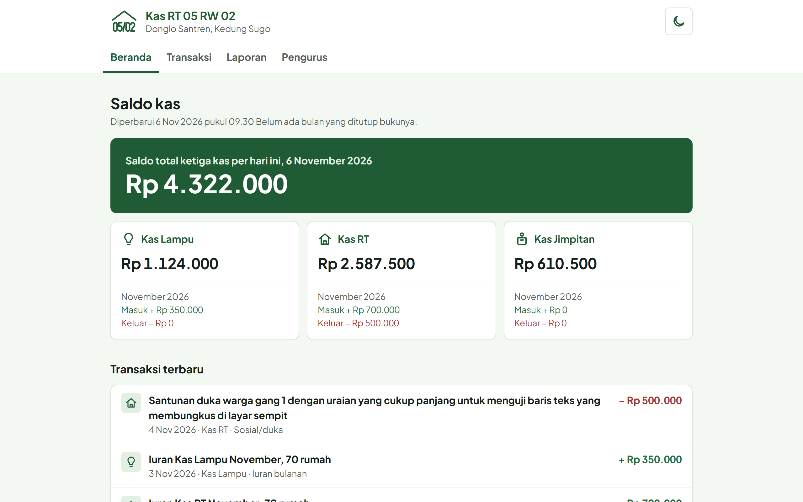
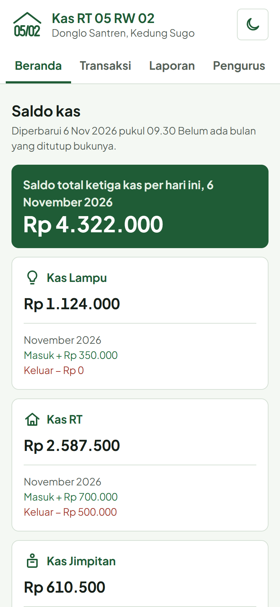
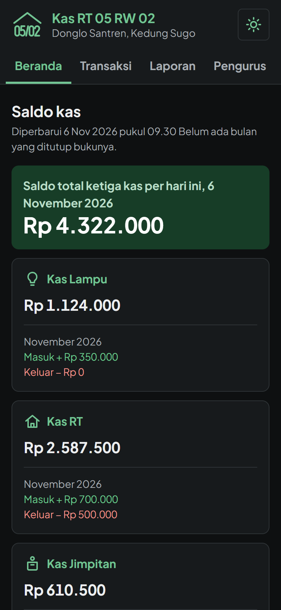
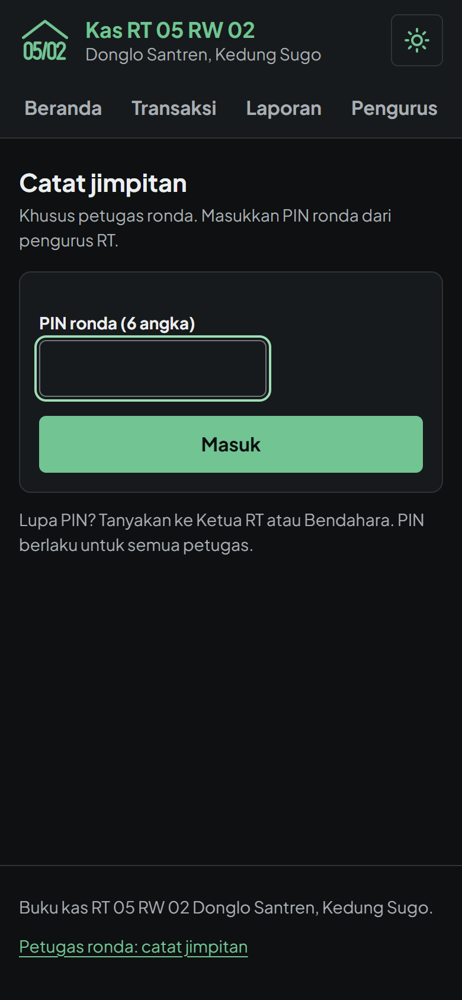
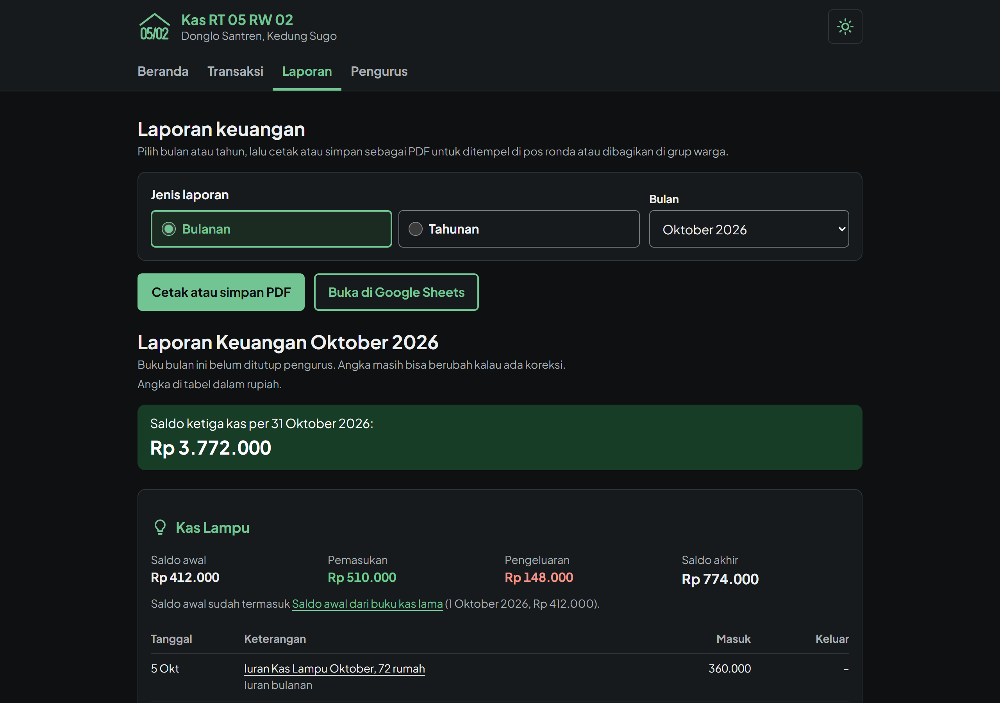

# Buku Kas RT 05 RW 02


Web keuangan untuk RT 05 RW 02 Donglo Santren, Kedung Sugo. Warga bisa melihat saldo, transaksi, foto nota, dan laporan bulanan dari HP tanpa login. Pengurus mencatat pemasukan dan pengeluaran, dan petugas ronda mencatat jimpitan dengan PIN.

Biaya operasionalnya Rp 0: web statis di Vercel, backend di Google Apps Script, data di Google Sheets. Tidak perlu server, Google Cloud Console, atau kunci API.



| HP, tema terang | HP, tema gelap | Halaman petugas ronda |
|---|---|---|
|  |  |  |



## Daftar isi

- [Fitur](#fitur)
- [Arsitektur](#arsitektur)
- [Teknologi](#teknologi)
- [Keamanan](#keamanan)
- [Aksesibilitas dan tampilan](#aksesibilitas-dan-tampilan)
- [Struktur proyek](#struktur-proyek)
- [Deploy](#deploy)
- [Memperbarui kode](#memperbarui-kode)
- [Lisensi](#lisensi)

## Fitur

**Untuk warga (tanpa login)**
- Saldo tiga kas (Kas Lampu, Kas RT, Kas Jimpitan) beserta pemasukan dan pengeluaran bulan ini.
- Daftar transaksi dengan filter kas, jenis, dan bulan. Setiap transaksi punya halaman detail dan foto nota kalau ada.
- Laporan bulanan dan rekap tahunan, bisa dicetak ke A4 atau disimpan sebagai PDF lengkap dengan kop dan kolom tanda tangan.

**Untuk pengurus (username dan password per orang)**
- Mencatat pemasukan, pengeluaran, dan pindah kas, dengan unggah foto nota yang dikecilkan di browser sebelum dikirim.
- Membatalkan transaksi yang salah. Transaksi tidak pernah dihapus atau diedit, jadi riwayatnya tetap utuh.
- Tutup buku bulanan berurutan. Bulan yang sudah ditutup terkunci, dan laporannya ditulis ke spreadsheet publik.
- Mengelola akun pengurus, mengganti PIN ronda, dan melihat log aktivitas.

**Untuk petugas ronda (PIN bersama)**
- Satu formulir sederhana untuk mencatat jimpitan ke Kas Jimpitan, dengan nama petugas wajib diisi.

**Berjalan otomatis**
- Laporan bulan sebelumnya ditulis ke spreadsheet LAPORAN setiap tanggal 1 pukul 01.00.
- Spreadsheet DATA dicadangkan setiap Minggu pukul 02.00. Yang disimpan 12 cadangan terakhir.

## Arsitektur

```
Browser (HP warga, pengurus, petugas)
        │
        ▼
Web statis: HTML + CSS + JavaScript (ES modules, tanpa build)   → Vercel
        │  fetch POST, Content-Type: text/plain
        ▼
Google Apps Script Web App (berjalan sebagai akun Google RT)
        ├── Spreadsheet DATA     (privat: transaksi, akun, log)
        ├── Spreadsheet LAPORAN  (publik, hanya lihat)
        └── Folder Drive NOTA    (foto nota)
```

Datanya disimpan di dua spreadsheet. DATA berisi hash password dan log aktivitas, jadi tetap privat. LAPORAN hanya berisi laporan bulanan dan dibagikan ke warga.

## Teknologi

| Bagian | Pilihan |
|---|---|
| Frontend | HTML, CSS custom properties, JavaScript vanilla (ES modules) |
| Backend | Google Apps Script (V8) |
| Database | Google Sheets |
| Penyimpanan foto | Google Drive |
| Hosting | Vercel (situs statis) |
| Huruf | Plus Jakarta Sans, di-host sendiri |

## Keamanan

- Password di-hash dengan SHA-256 bersalt yang diulang 2.000 kali, karena Apps Script tidak menyediakan bcrypt.
- Setelah 5 kali gagal masuk, akun dikunci 15 menit. Sesi admin berlaku 6 jam, sesi ronda 1 jam.
- Setiap aksi tulis dicek di server: peran, nominal maksimum, ukuran dan jenis file foto (dicek dari isi file, bukan dari namanya).
- Penulisan memakai `LockService`, jadi dua pengurus yang menyimpan bersamaan tidak saling menimpa.
- Content Security Policy ketat di `web/vercel.json`. Tidak ada skrip pihak ketiga, dan teks dari pengguna selalu ditulis lewat `textContent`.

## Aksesibilitas dan tampilan

- Dirancang untuk HP sejak awal dan diuji dari lebar 360 px sampai desktop, termasuk pada ukuran huruf 200%.
- Tema terang bawaan, dengan tema gelap yang bisa dipilih lewat tombol di header. Pilihannya diingat di browser.
- Bisa dipakai sepenuhnya dengan keyboard. Pemilih tanggal berbahasa Indonesia dibuat sendiri, dan kontras warna memenuhi WCAG AA.
- Hasil pemeriksaan axe-core: 0 pelanggaran.

## Struktur proyek

```
├── apps-script/          Backend, disalin ke editor Apps Script
│   ├── appsscript.json   Manifes: zona waktu dan runtime
│   ├── Kode.gs           Router aksi, validasi, utilitas
│   ├── Auth.gs           Login, sesi, akun pengurus, PIN ronda
│   ├── Transaksi.gs      Catat, batal, daftar, ringkasan, foto
│   ├── Laporan.gs        Laporan bulanan dan tahunan, tutup buku, cadangan
│   └── Setup.gs          Setup awal, admin pertama, pemulihan akses
├── web/                  Frontend statis (Root Directory di Vercel)
│   ├── *.html            Beranda, transaksi, detail, laporan, pengurus, ronda
│   ├── css/              Token desain, gaya utama, gaya cetak
│   ├── js/               Satu modul per halaman dan modul bersama
│   └── vercel.json       Header keamanan dan cache
└── docs/screenshots/     Gambar untuk README
```

## Deploy

Semua layanan yang dipakai gratis. Untuk pertama kali, perkiraan waktunya 1 sampai 2 jam.

### Yang dibutuhkan

- **Akun Google khusus RT**, bukan akun pribadi. Semua data, foto nota, dan cadangan tersimpan di akun ini, jadi akun ini harus bisa diserahkan ke pengurus berikutnya. Aktifkan verifikasi 2 langkah.
- **Akun GitHub** dan **akun Vercel** (paket Hobby, daftar lewat "Continue with GitHub").

### 1. Backend di Google Apps Script

Semua langkah ini dilakukan sambil masuk dengan akun Google RT.

1. **Buat proyek.** Buka [script.google.com](https://script.google.com), klik **Proyek baru**, lalu beri nama `Kas RT 05 RW 02`. Di **Setelan proyek**, centang **Tampilkan file manifes "appsscript.json" di editor**.
2. **Salin kode.**
   - Ganti isi `appsscript.json` dengan file yang sama dari folder `apps-script/`.
   - Ganti nama file bawaan menjadi `Kode`, lalu buat file skrip `Auth`, `Laporan`, `Setup`, dan `Transaksi`.
   - Isi kelima file dengan file bernama sama dari `apps-script/`, lalu simpan.
3. **Jalankan `setupAwal`.** Pilih fungsi itu, klik **Jalankan**, lalu izinkan aksesnya.
   - Peringatan "Google belum memverifikasi aplikasi ini" wajar untuk skrip buatan sendiri: klik **Lanjutan**, lalu **Buka … (tidak aman)**.
   - Fungsi ini membuat folder di Drive berisi spreadsheet DATA dan LAPORAN, folder `Nota`, dan folder `Cadangan`, lalu memasang pemicu laporan bulanan dan cadangan mingguan.
   - Catat alamat kedua spreadsheet dan **PIN ronda awal** dari Log eksekusi.
4. **Jalankan `ukurWaktuHash`.** Kalau hasilnya jauh di atas 1.000 ms, turunkan `ITERASI_HASH` di `Auth.gs` (misalnya ke 1000) sebelum langkah berikutnya. Angka ini tidak boleh diubah lagi setelah akun pengurus dibuat.
5. **Buat admin pertama.** Isi `ADMIN_PERTAMA` di baris atas `Setup.gs`:
   ```js
   const ADMIN_PERTAMA = { username: 'bendahara', nama: 'Nama Bendahara', jabatan: 'Bendahara' };
   ```
   Jalankan `buatAdminPertama`, lalu catat **password sementara** dari log. Setelah itu kosongkan lagi `ADMIN_PERTAMA`.
6. **Deploy sebagai Web App.** Klik **Terapkan**, pilih **Deployment baru**, lalu jenis **Aplikasi web**.
   - Jalankan sebagai: **Saya**.
   - Siapa yang memiliki akses: **Siapa saja**.
   - Salin URL yang berakhiran `/exec`.

   Akses "Siapa saja" diperlukan agar warga bisa melihat saldo tanpa login. Spreadsheet DATA tetap privat, karena skrip berjalan sebagai akun RT dan setiap aksi tulis diperiksa sesinya di server.

### 2. Frontend di Vercel

1. **Isi alamat server.** Di `web/js/config.js`, isi URL `/exec` dari langkah sebelumnya, lalu commit dan push:
   ```js
   export const API_URL = 'https://script.google.com/macros/s/AKfy.../exec';
   ```
   URL ini bukan rahasia, karena browser warga memang memanggilnya.
2. **Import ke Vercel.** Di [vercel.com](https://vercel.com), klik **Add New → Project**, lalu import repositori ini. Atur:

   | Setelan | Nilai |
   |---|---|
   | Framework Preset | `Other` |
   | Root Directory | `web` |
   | Build Command / Output Directory | dikosongkan |

   **Root Directory wajib `web`**, supaya hanya folder itu yang tampil di internet.
3. **Deploy.** Buka alamat web yang diberikan. Beranda menampilkan `Rp 0` untuk ketiga kas dan pesan "Belum ada transaksi".

### 3. Pertama kali dipakai

1. Buka menu **Pengurus**, masuk dengan password sementara, lalu buat password baru.
2. Di tab **Akun dan pengurus**:
   - tambahkan pengurus lain;
   - ganti PIN ronda awal.
3. Di tab **Catat transaksi**, catat **saldo awal** setiap kas: jenis Pemasukan, kategori Saldo awal, dengan tanggal mulai pembukuan.
4. Bagikan alamat web ke warga. Bagikan alamat `/ronda.html` dan PIN-nya ke koordinator ronda.

## Memperbarui kode

- **Backend.** Ubah file `.gs` di editor Apps Script. Lalu klik **Terapkan → Kelola deployment**, klik ikon pensil, pilih **Versi baru**, lalu **Terapkan**.

  Jangan membuat "Deployment baru", karena URL `/exec`-nya akan berubah. Kalau versi baru lupa diterapkan, web akan menampilkan pesan "Aksi tidak dikenal".
- **Frontend.** Push ke GitHub. Vercel memasang versi baru dalam 1 sampai 2 menit.

  Kalau skrip pendek di `<head>` (pemilih tema) diubah, perbarui juga hash `sha256-…` di `web/vercel.json`, karena CSP hanya menjalankan skrip yang hash-nya terdaftar. Skrip itu harus sama persis di keenam halaman. Hitung hash barunya dengan:
  ```bash
  node -e "const s=require('fs').readFileSync('web/index.html','utf8').match(/<script>([\s\S]*?)<\/script>/)[1];console.log('sha256-'+require('crypto').createHash('sha256').update(s).digest('base64'))"
  ```

## Lisensi

Kode proyek ini dirilis di bawah [Lisensi MIT](LICENSE).

Huruf [Plus Jakarta Sans](https://github.com/tokotype/PlusJakartaSans) karya Tokotype dirilis di bawah SIL Open Font License 1.1. Teks lisensinya ada di [`web/fonts/OFL-plus-jakarta-sans.txt`](web/fonts/OFL-plus-jakarta-sans.txt).
